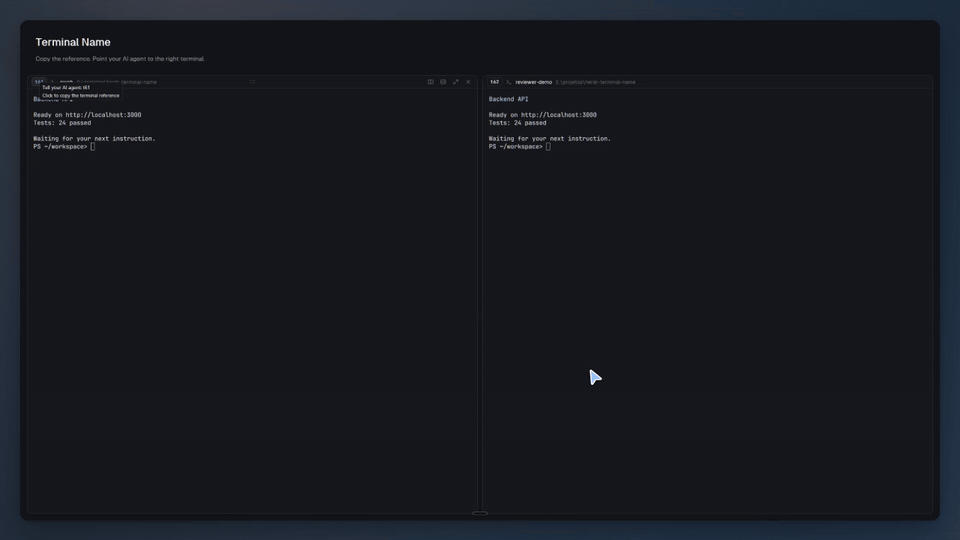

# Terminal Name for Herdr

[Português brasileiro](README.pt-BR.md)



Point your AI agent to the right terminal without running a command. A small native header badge shows the exact Herdr Core reference, such as **`t58`**. Existing native terminal names appear beside it. Click the badge to copy the reference, then say: **“Read terminal t58.”**

[View the full-size screenshot](preview.png).

## Install with your agent

Give an agent that can edit your Herdr installation this instruction:

> Read my installed `~/.config/herdr-app/AGENTS.md`, then install the mod from https://github.com/jeanlorencini/herdr-terminal-name. Read RECIPE.md and all mod files first. Preserve my layout and existing controls. Connect `terminal-name` to the pane header of a personal layout, resolving name conflicts without overwriting another mod. Use English, or set `content.pane.header.content.props.language` to `pt-BR` for Brazilian Portuguese. Run `herdr-app check`, inspect status, and verify the live result.

This is a **mod**, not a replacement layout. Copying its folder alone does not attach it to pane headers.

## Manual installation

1. Find your app home: `$HERDR_APP_HOME` when set, otherwise `~/.config/herdr-app` (including Windows).
2. Copy `mods/terminal-name/` into that home's `mods/`. If the destination already exists, inspect it first; rename the incoming mod and its `mods/terminal-name/` asset references when necessary.
3. Duplicate a shipped layout before editing it. In your chosen personal layout's tab block, set the pane header's `content.mod` to `terminal-name`. Preserve the other pane/header fields and any custom header you already rely on. This partial example shows the fields to merge, not a complete layout:

```json
{
  "header": {
    "content": {
      "mod": "terminal-name",
      "props": { "language": "en" }
    },
    "height": 30,
    "position": "top",
    "reveal": "always"
  }
}
```

4. Use `lone: true` in the pane frame if the header should also appear when a tab has only one pane.
5. Run the native checks against your installed mod folder:

```powershell
herdr-app check "$HOME/.config/herdr-app/mods/terminal-name"
herdr-app status
```

Use your actual app home if it differs. Save to reload; no app/core restart is needed. Inspect the live header too: a passing initial check is not a full interaction test.

## English and Brazilian Portuguese

One mod contains both translations. English is the default. Set header `content.props.language` to `"en"` or `"pt-BR"`; `pt` variants select Portuguese, unsupported values fall back to English. This controls the mod's own labels, tooltips, copy confirmation and blocked-state text; program names and native terminal names remain as reported by Herdr.

Herdr App 0.1.15 exposes no documented UI-locale preference to mods, so this release uses explicit selection rather than guessing from your machine. Node.js, npm and external translation services are **not needed to use the mod**.

## Behavior and scope

- The badge contains the complete terminal address, including a remote machine prefix such as `vps/t58`; it never abbreviates an address into an unusable target.
- Native names are looked up by exact address. A program title such as “Codex” is not presented as a new alias.
- Split, zoom, close and header-focus actions still use the correct pane target. Closing a pane ends its terminal, just as in the native header.
- Mod panes have no terminal reference badge. The badge identifies the terminal associated with the pane in Herdr's model; temporary `terminal.show` substitutions and overlays are separate surfaces.
- No network requests, external programs, credential access or file reads are performed by this mod. Clipboard text changes only when you activate the badge.
- To uninstall, restore the header's previous mod reference before removing this mod's files. Keep your other layout fields.

## Compatibility and verification

Tested on Windows with **Herdr App 0.1.15**. The source uses native `gpui-kit`, `gpui-base` and `herdr` APIs. Linux, macOS, other releases, light themes and live remote machines have not been visually validated. Very narrow headers may have insufficient space for an unusually long remote address.

Focused tests exercise both languages, exact reference copying, remote addresses, native names, metadata updates, controls and status rendering. They use inert elements and a mock clipboard. Native mod checks and live screenshots were also inspected. The animated demo additionally records a real Windows mouse click, the native tooltip and copy confirmation; the copied reference was checked against the clipboard. Keyboard navigation has not been automated. The preview uses real, temporary demo terminals in a simplified presentation layout; the mod does not install that layout or rename your terminals.

For development only, use Node.js 22 or newer:

```sh
npm test
```

There are no npm dependencies. See [RECIPE.md](RECIPE.md) for a rebuild brief and [CHANGELOG.md](CHANGELOG.md) for changes.

## License and credits

Apache-2.0. Adapted from Herdr App's native `pane` header. Modified files identify the changes. Included SVGs retain the Lucide/Feather ISC/MIT notices in [licenses/LICENSE-Lucide.txt](licenses/LICENSE-Lucide.txt). See [LICENSE](LICENSE) and [NOTICE](NOTICE). This is an independent community mod.
