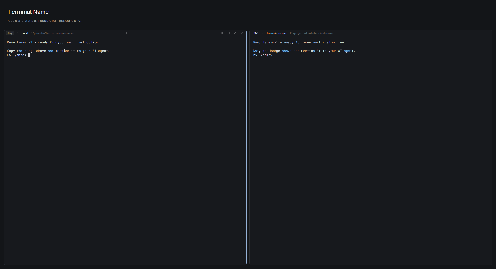

# Terminal Name para Herdr

[English](README.md)

Indique o terminal certo à IA sem executar comandos. Um selo discreto no cabeçalho mostra a referência exata do Herdr Core, como **`t58`**. Se o terminal já tiver nome nativo, ele aparece junto. Clique no selo para copiar e diga: **“Leia o terminal t58.”**



## Instalar com sua IA

Passe esta instrução a um agente que possa editar sua instalação do Herdr:

> Leia meu `~/.config/herdr-app/AGENTS.md` instalado e depois instale o mod de https://github.com/jeanlorencini/herdr-terminal-name. Leia RECIPE.md e os arquivos do mod antes de instalar. Preserve meu layout e controles existentes. Conecte `terminal-name` ao cabeçalho dos panes de um layout pessoal, sem sobrescrever outros mods. Configure `content.pane.header.content.props.language` como `pt-BR`. Execute `herdr-app check`, confira o status e observe o resultado no aplicativo.

É um **mod**, não um layout completo. Copiar a pasta sem ligar o cabeçalho ao mod não exibe o selo.

## Instalação manual

1. Localize a pasta do app: `$HERDR_APP_HOME`, quando definida, ou `~/.config/herdr-app`, inclusive no Windows.
2. Copie `mods/terminal-name/` para `mods/` nessa pasta. Se o nome já existir, confira o conteúdo antes; renomeie a nova cópia e suas referências de assets quando necessário.
3. Duplique um layout de fábrica antes de editar. No bloco de abas do layout pessoal escolhido, configure o `content.mod` do cabeçalho como `terminal-name`. Preserve os demais campos e não substitua silenciosamente outro cabeçalho personalizado. Este trecho é parcial, para mesclar ao layout existente:

```json
{
  "header": {
    "content": {
      "mod": "terminal-name",
      "props": { "language": "pt-BR" }
    },
    "height": 30,
    "position": "top",
    "reveal": "always"
  }
}
```

4. Use `lone: true` na moldura do pane se o cabeçalho também deve aparecer quando a aba tem um pane só.
5. Confira a cópia instalada:

```powershell
herdr-app check "$HOME/.config/herdr-app/mods/terminal-name"
herdr-app status
```

Adapte o caminho à sua pasta real do app. Salvar recarrega a interface sem reiniciar App/Core. Confira também a interface: o check inicial não substitui testar a interação.

## Idiomas

O mesmo mod inclui inglês e português brasileiro. Configure `header.content.props.language` como `"pt-BR"` ou `"en"`. Variantes de `pt` selecionam português; opções desconhecidas usam inglês. A tradução cobre rótulos, tooltips, confirmação de cópia e status que pede sua atenção. Nomes de programas e terminais continuam como o Herdr os informa.

O Herdr App 0.1.15 não documenta uma preferência de idioma acessível aos mods. Por isso, a seleção é explícita. Sua instalação pode ficar em português sem duplicar o código. Node.js e npm não são necessários para usar o mod.

## Comportamento e limites

- A referência é completa, incluindo máquina remota, como `vps/t58`. Ela não é um Pane ID abreviado.
- O nome nativo é consultado pelo endereço exato. O mod não cria aliases visuais nem renomeia terminais.
- Divisão, zoom, foco e fechamento mantêm seus alvos. Fechar um pane encerra seu terminal, como no cabeçalho nativo.
- Panes de mod não recebem referência falsa. O selo identifica o terminal associado ao pane no modelo; overlays e substituições temporárias com `terminal.show` são superfícies distintas.
- O mod não faz rede, executa programas externos, lê credenciais ou arquivos. Só altera o texto do clipboard quando o selo é ativado.
- Para remover, restaure a referência anterior do cabeçalho antes de excluir a pasta do mod.

Testado no Windows com **Herdr App 0.1.15**. Linux, macOS, outras versões, tema claro e máquinas remotas reais não tiveram validação visual. Endereços remotos muito longos podem não caber num cabeçalho extremamente estreito.

Os testes focados cobrem os dois idiomas, cópia exata, nomes, remotos, metadados, controles e status, com elementos inertes e clipboard substituto. Também foram examinados o check nativo e capturas reais. Clique físico, teclado e tooltip real não foram automatizados. As imagens usam terminais temporários de demonstração num layout simplificado; esse layout não é instalado pelo mod.

Para desenvolver, use Node.js 22 ou superior e execute `npm test`. Não há dependências npm. A receita canônica está em [RECIPE.md](RECIPE.md), em inglês. Veja [CHANGELOG.md](CHANGELOG.md). O GIF ficará para uma tarefa posterior.

## Licença e créditos

Apache-2.0, com origem no cabeçalho `pane` do Herdr App. Alterações estão identificadas no código. SVGs preservam os avisos ISC/MIT de Lucide/Feather em [licenses/LICENSE-Lucide.txt](licenses/LICENSE-Lucide.txt). Veja [LICENSE](LICENSE) e [NOTICE](NOTICE). Mod independente da comunidade.
