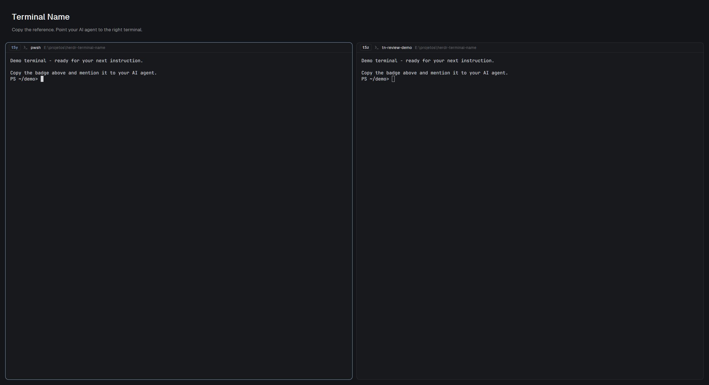

# Terminal Name

A small native badge at the start of each terminal pane header shows the complete Herdr Core reference, such as `t58`. People can copy it and tell their AI agent which terminal they mean. Existing native terminal names appear beside the reference. The rest of the header stays familiar. English and Brazilian Portuguese are included.

## What you see

- In a 30px pane header, left to right: a reference badge, the program icon, the terminal's native name or existing program/title, its folder, current agent status, and the familiar hover controls.
- The badge is 20px high, with 7px horizontal padding, radius 5px, a 1px theme border and theme surface background. It uses JetBrains Mono 11px semibold. Focused panes use the accent color; other references use foreground. Hover uses the theme hover background and accent text.
- The surrounding native row has 10px horizontal padding, 8px gaps and 12px title text. The title and folder can shrink; the reference does not abbreviate. The divider follows the terminal-facing edge, including bottom headers.
- User terminal names and program names are never translated or replaced with invented aliases.

## How it behaves

- Click the badge: copy only the exact terminal address, stop propagation and show an 1800ms localized notification explaining how to refer to it. The tooltip and accessible label describe that action.
- Click the surrounding header: focus its own pane. Hover reveals split-right, split-down, zoom/restore and close controls, with localized labels. Close ends the pane's terminal, as in the native app.
- Working: the native 12px spinner rotates every 900ms. Blocked: a compact 18px badge reads “Needs you” or “Precisa de você”. Done: a 7px status dot. Idle: no added status decoration.
- Read header `props.language`: default `en`; Portuguese variants such as `pt` or `pt-BR` select `pt-BR`. Unsupported values fall back to English. There is no claimed automatic detection: Herdr App 0.1.15 documents no UI locale for mods.
- Names update from live metadata. Without a native name, keep the original program/title fallback. A pane without a terminal has no reference badge. No new keys are bound.

## Built from

- Install only `mods/terminal-name/`; no `layouts/` folder or `keys.json` is distributed. Connect an existing personal tab frame's `pane.header.content.mod` to `terminal-name`. Its `content.props.language` selects the language. Keep the person's other frame fields, and clone shipped layouts before structural edits.
- `main.js` is an adaptation of Herdr's native `pane` View. `i18n.js` holds the complete English/Portuguese messages and deterministic language selection. The app supplies `props.pane` and `props.terminal`.
- `panes()` finds this copy's own pane; `terminals()` looks up the existing native name by exact terminal address. `theme()`, `home()` and `layout()` preserve the native styling, folder display and divider position. No polling or cached context is used.
- Native `Button` and `cx.write_to_clipboard` implement copying; `notify()` publishes feedback. `run()` dispatches `pane.focus`, `pane.split`, `pane.zoom` and `pane.close` with explicit pane targets. `gpui-kit` draws div/svg/image/View; `gpui-base` supplies the row and Button.
- Included assets: close, split-right, split-down, zoom, unzoom and spinner SVGs. The mod references its own asset folder. Program icons still come from Herdr's native program metadata.
- No network access, external programs, credential/file reads or terminal-input automation. Apache-2.0 source attribution and Lucide/Feather icon notices accompany the files.

## Watch out

- A Pane ID (`p…`) is a visual-layout handle; the badge must copy the terminal's exact Core address (`t…` or `machine/t…`). Never copy the pane ID, a program title or a shortened remote address.
- The address refers to the terminal associated with the pane in Herdr's model. Overlays and temporary `terminal.show` substitutions are distinct surfaces.
- Do not infer a terminal alias from an agent's title. The installed Core schema supports names at creation and lookup by name, but exposes no `terminal.rename` operation. This mod does not rename existing terminals.
- A `place: none` mod is not shown merely by copying its folder. Connect the personal layout header, and use `lone: true` if a single pane also needs a frame.
- Never overwrite an existing mod or custom header. Resolve name conflicts and update the asset paths when renaming this mod. Revert to the previous header mod to uninstall.
- Follow the generated types from the installed Herdr version. Do not ship a generated API snapshot as the authority for another installation. Node is used only for development tests.
- Very long machine names can exceed a narrow header. Windows and App 0.1.15 were tested; no visual guarantee is made for macOS/Linux, other versions, light themes or live remote hosts. Physical click/keyboard/tooltip automation was not performed; handler tests use a mock clipboard.
- Previews use real temporary demo terminals with a simplified presentation layout, which is not part of this mod. The public default is English; Jean's own layout explicitly uses `pt-BR`.

## Done when

- `herdr-app check <installed-mod-folder>` passes and the running app reports no mod/layout errors.
- Headers in different panes and tabs show the exact addresses reported by Herdr, including an existing native name when present.
- Activating a reference copies that terminal's address, while header and control actions retain their own pane targets.
- English and Portuguese each translate labels, tooltip, feedback and blocked status. Missing/unsupported language settings use English.
- Existing icons, folders, statuses and controls remain present across narrow panes, focus changes and zoom. A mod pane receives no false terminal address.
- The person's existing layout and running terminals remain intact; temporary demo resources are cleaned up. Portable focused tests pass without personal paths or npm dependencies.
